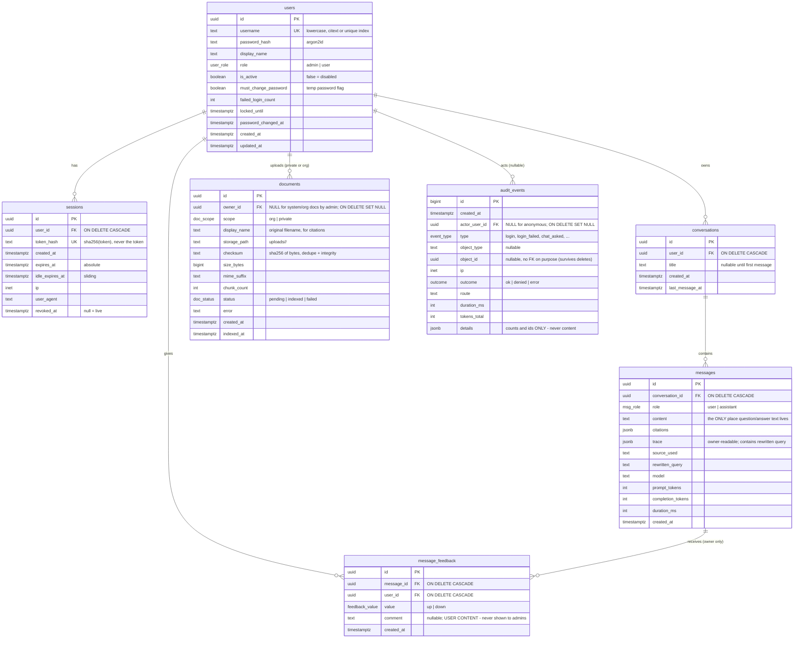
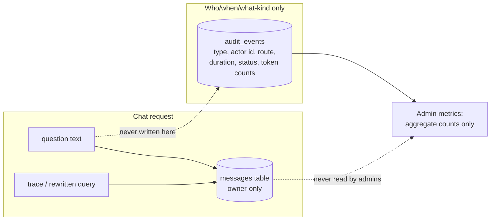

# Multi-User Backend Design — Phase A

**Status:** Design only. No application code, no migrations, no data changes.
**Branch:** `backend/multi-user`
**Date:** 2026-10-22
**Product rules:** `admin`/`user` roles · admins manage users and documents ·
conversations are readable **only** by their owner (admins included in "nobody
else") · admins are users too · no sign-up · users see/delete only their own
conversations.

Every claim about current code below was verified by reading the code on this
branch (file:line references). Items marked **DECISION FOR FARHAD** are open
choices with a recommendation — none are silently decided. A consolidated list
is in §13.

---

## A1. Current-state inventory

### Authentication today

| What | Where | Notes |
|---|---|---|
| Shared optional chat key | `app/api/routes.py:29-33` | `POST /api/chat` checks `X-API-Key` against `CHAT_API_KEY` **only if that env var is set**. One key shared by everyone; no identity. |
| Shared admin key | `app/api/routes.py:70-76` | `POST /api/ingest` requires `X-Admin-Key` == `ADMIN_API_KEY`. Unconditional. |
| Default admin key | `app/core/config.py:8,25` | `ADMIN_API_KEY` defaults to `"change-me"`; `validate_admin_key` (`config.py:40-51`) refuses startup outside development with the default (fix M4), warns in dev. |
| Chat-key-off warning | `app/core/config.py:54-61` | Warns at startup when `CHAT_API_KEY` unset (i.e. `/api/chat` fully open). |
| Users / sessions / login | — | **Do not exist.** No user table, no cookie handling, no session middleware, nothing. |

### Audit logging today — the privacy problem

- `app/services/audit.py:15-32` creates SQLite table `query_audit` in
  `data/audit.db` (`AUDIT_DB_PATH`, `config.py:28`). Columns: `id`,
  `created_at`, **`question` (full question text)**, `source_used`,
  `trace_json`, `client_ip`, `authenticated`, `duration_ms`.
- `app/api/routes.py:46-53` calls `write_audit(payload.question, …)` on every
  chat — so **every question asked is stored verbatim, keyed only by IP, in a
  file any server-side process can read**. `README.md:160` documents this
  ("Every question is audited"). The local `data/audit.db` currently holds 8
  such rows.
- `trace_json` is worse than it looks: the LangGraph trace contains
  `"Query rewrite → {rewritten}"` (`app/rag/workflow.py:157-161`), and the
  rewritten query is derived from the question — so the audit row carries
  question-adjacent content even beyond the `question` column.
- No endpoint reads the audit table (`app/api/routes.py` exposes only
  `/api/health`, `/api/chat`, `/api/ingest`). `steps.md` item 11 mentions an
  "audit information" endpoint that was never built — doc drift, not a leak.
- Semantics bug worth noting: `authenticated=bool(settings.chat_api_key)`
  (`routes.py:51`) records *whether auth was configured*, not *whether the
  caller authenticated*. The column name lies. (Moot after this redesign.)

### Ingest today

- `app/api/routes.py:70-87`: upload → written to `uploads/<basename>`
  (basename via `Path(...).name`, so no path traversal) → `load_file` →
  `chunk_documents` (`RecursiveCharacterTextSplitter`, 900/120,
  `app/services/ingestion.py:27-29`) → Pinecone. Supported: pdf/txt/md/docx
  (`ingestion.py:9`). Success response includes chunk count.
- **Identity of a document is its `source` path string.** Chunk IDs are
  `sha256(source + "\0" + start_index + "\0" + content)`
  (`app/rag/vectorstore.py:125-132`), and re-ingest deletes by
  `{"source": {"$eq": src}}` before adding (`vectorstore.py:135-147`, fix M2).
  Consequence for multi-user: **two users uploading the same filename produce
  identical `source` values → identical chunk IDs and a delete that wipes both
  documents' chunks.** This is the collision the redesign must remove.
- `uploads/` collisions too: same-name upload overwrites the file
  (`routes.py:82-83`).
- `ingest_sample_kb.py:1-17` indexes `data/sample_kb/` (2 fictional NovaRetail
  docs) with `source` set to the local file path.

### Retrieval and namespace today

- One Pinecone index, one namespace for everything:
  `PINECONE_INDEX_NAME`/`PINECONE_NAMESPACE` default
  `enterprise-agentic-rag` (`app/core/config.py:16-17`).
- `get_vectorstore()` (`vectorstore.py:107-116`) builds
  `PineconeVectorStore(index, embedding, namespace)`; `get_retriever()`
  (`vectorstore.py:120-121`) uses `k=top_k` (4) **with no metadata filter at
  all**. Whoever can call `/api/chat` retrieves everything ever ingested.
- Dimension-mismatch guard (`vectorstore.py:76-83`): refuses to start on an
  index with the wrong dimension and explicitly never deletes data.
  ⚠️ `README.md:159` still claims changing `EMBEDDING_MODEL` "deletes and
  recreates the Pinecone index — your vectors go with it". **The README is
  stale**; the code fails loudly instead. Fix the README in Phase B.

### Logging today

- `app/core/logging.py:3-7`: `basicConfig(INFO)` to stdout/stderr. That's all.
- Grep of every `logger.*` in `app/`: `workflow.py:62` (timeout, no content),
  `workflow.py:106` (**logs the Tavily error object verbatim** — normally an
  HTTP status message, but a malformed Tavily response could echo query
  fragments), `routes.py:65` (`logger.exception("chat request failed")` —
  static message, but the traceback may include library exception text that
  echoed request details), plus startup warnings in `config.py`.
- **Conclusion: no log line intentionally contains question text.** The
  residual risks are exception payloads and anything uvicorn/access-log
  future changes introduce. Phase B adds a test that pins this (§A11).

### LangSmith / tracing today

- `langsmith==0.14.8` is installed as a transitive dependency of langchain.
- Tracing is **opt-in by env var only**: `langsmith/utils.py:121-142` enables
  it iff `LANGSMITH_TRACING`/`LANGCHAIN_TRACING_V2 == "true"`;
  `README.md:105` documents it. No `.env` value is currently set for it.
- If someone sets it, the **full question, retrieved chunks, web results and
  answers are sent to LangSmith's cloud.** See §A2 mitigations.

### Existing frontend's auth assumptions

- `templates/index.html:31-32`: a "Chat API key (optional)" password field;
  `static/js/app.js:8-11` persists it in `localStorage`.
- `app.js:109-116`: every chat call sends `X-API-Key: <localStorage value>`.
- Upload modal asks for the admin key in a plain input (`index.html:105`,
  `app.js:151-174`) and POSTs it as `X-Admin-Key`.
- No login, no cookies, no conversation history UI, no user concept. The new
  frontend (login, chat-history sidebar, admin area) does not exist yet —
  this document defines its API contract (§A8).

### Runtime/deployment facts the design must respect

- Single uvicorn process, non-root container, healthcheck on `/api/health`
  (`Dockerfile:18-25`). No docker-compose file exists yet.
- In-memory, per-instance, per-IP sliding-window limiter for chat
  (`app/services/ratelimit.py:1-31`, `routes.py:34-41`).
- CI runs the pytest suite offline + `pip-audit` on Python 3.13
  (`.github/workflows/ci.yml`). Tests force empty API keys and a temp audit DB
  (`tests/conftest.py:7-11`) and use `TestClient` + `monkeypatch` + fake
  vectorstore patterns (e.g. `tests/test_ingest_ids.py`).
- SQLAlchemy **2.1.4 is already pinned** in `requirements.txt` (pulled in by
  `langchain-classic`/`langchain-community`) — adopting it explicitly for our
  own schema adds no new package.
- `state/` is an empty directory; `Agentic-RAG-demo/` is a standalone
  notebook demo, out of scope. `data/audit.db` and `uploads/` are gitignored.

---

## A2. Threat model (short, honest)

**What we protect:** user conversations (questions, answers, titles, traces)
and per-user private documents — against *other authenticated users*, against
*curious admins*, and against accidental exposure through *logs, audit files,
and backups*. Plus the service itself against anonymous internet actors
(brute force, free LLM usage, ingest abuse).

**Who we defend against, concretely:**

| Adversary | Threat | Defense in this design |
|---|---|---|
| Another authenticated user | Reads B's conversations by guessing IDs; retrieves B's private doc chunks via chat | UUIDv7 IDs + owner checks returning **404**, server-side retrieval filter (§A7), authorization tests as the core suite (§A11) |
| Curious admin | Reads employee questions via an endpoint, export, or the audit table | Rule 3: no such endpoint exists (§A8 lists what must NOT exist); content lives owner-only in `messages`; `audit_events` carries no content (§A6); old `query_audit` retired (D2) |
| Anonymous internet | Login brute force; unauthenticated chat/ingest | Login rate limit + temporary lockout (§A5), 401 everywhere except health/login, argon2id hashes |
| Leaked DB backup / stolen laptop | Password or session reuse; content exposure | argon2id hashes, sessions stored as SHA-256 **token hashes** (a leaked sessions table can't be replayed), message content still readable in plaintext — see limits below |
| Compromised browser | XSS steals cookie; CSRF | httpOnly + Secure + SameSite cookie, CSRF tokens, the UI's escape-first markdown renderer stays (fix from `static/js/app.js:25-71`) |

**Explicitly out of scope / honest limits — state these to stakeholders:**

1. **Whoever has server or database access can read everything.** The admin
   who can `psql` into Postgres, or root on the Docker host, can read
   `messages.content`, Pinecone chunk text, and log files. No application
   design changes that. (Mitigation path: field-level encryption of message
   content at rest, listed as a later option in §A9 — it protects against
   *passive DB/backup* reads, not against the running server.)
2. **Third parties that receive question text can see it.** OpenAI (LLM calls
   + embeddings) and Tavily (web fallback receives `current_query`,
   `workflow.py:100`) receive user content. If `LANGSMITH_TRACING=true`, the
   full trace (question, chunks, answers) also goes to LangSmith's cloud.
   Mitigations: tracing stays **off by default** and is called out in
   `.env.example` as "sends user content to a third party"; no question text
   in application logs (pinned by test); a deployment-level kill switch for
   the web fallback is noted in D6. If the company later requires it, the LLM
   vendor choice/contract is the lever — not this codebase.
3. **Pinecone chunk text** is stored in Pinecone's cloud (US region,
   `vectorstore.py:90`). Anyone with the Pinecone API key can read chunk
   text of all documents. Private documents are access-controlled *through
   our API*, not encrypted in Pinecone (see D12 for the honest trade-off).
4. **Timing/metadata leaks are accepted:** admins will see aggregate counts
   and can infer "someone asked questions today" — but never what was asked.

---

## A3. Stack

| Component | Choice | Rationale / challenge |
|---|---|---|
| Database | **PostgreSQL 18** (`postgres:18-alpine` in a new `docker-compose.yml` for local dev; prod via `DATABASE_URL`) | Sessions, lockout counters and transactions want a real DB. SQLite would fight us on concurrent writes and row-level constraints. **D1** |
| ORM / migrations | **SQLAlchemy 2.x** (already pinned, `requirements.txt`) + **Alembic** (new dep — versioned, reviewable schema migrations for 7 new tables; no runtime auto-create in production) | SQLAlchemy costs nothing new. Alembic is the standard companion. |
| Driver | **psycopg 3** (`psycopg[binary]`, new dep — the Postgres DBAPI driver SQLAlchemy talks to; sync variant matches the existing sync route style) | |
| Password hashing | **argon2id** via `argon2-cffi` (new dep — OWASP-recommended memory-hard hashing; `hashlib`-only options are weaker, `passlib` is unmaintained) | |
| Sessions | **Server-side sessions in Postgres.** 256-bit random token in an httpOnly + Secure + SameSite=Lax cookie; DB stores only SHA-256(token). **No JWT** — a JWT would either outlive logout or need a denylist, which is a session table with worse ergonomics. | |
| CSRF | Double-submit token: non-httpOnly `csrf` cookie + `X-CSRF-Token` header required on all mutating requests; SameSite=Lax as the outer layer | Same-origin deployment makes this simple. |
| Login protection | Per-IP sliding window (reuse `SlidingWindowLimiter`) **and** per-username failed-attempt lockout in Postgres: 5 failures → 15 min, doubling to 1 h. Generic error text (no user enumeration). | |
| Chat rate limiting | Existing `SlidingWindowLimiter` **re-keyed from IP to user_id** (plus keep IP limit for `/api/auth/login` only). Still in-memory, single-process — documented limitation; move to Postgres-backed counters if multi-worker deployment arrives. | |
| Deployment | Same-origin: FastAPI serves the built frontend (existing pattern, `app/main.py:22-27`). **No CORS middleware at all** — the strongest CSRF posture is not needing cross-origin in the first place. | |

What would change these choices: a mandated Redis/Keycloak SSO from company
IT (sessions/lockout move there), or a decision to run multi-worker/replicas
(rate limiting and per-instance state must go shared first — D14).

---

## A4. Data model

All IDs are UUIDv7 (time-ordered, safe in URLs, non-guessable in practice).
All timestamps `timestamptz`. Enums via native PG enums or CHECK constraints —
implementation detail for Phase B; shown here as enums.



Constraints and indexes (minimum):

- `users.username` unique (stored lowercase). Role CHECK in (`admin`,`user`).
- `sessions.token_hash` unique; index `(user_id)`, index `expires_at` for the
  cleanup sweep. FK `user_id → users.id ON DELETE CASCADE` (disable/delete
  user kills sessions instantly and permanently).
- `conversations (user_id, last_message_at DESC)` for the sidebar listing.
- `messages (conversation_id, created_at)`; conversation and user ownership
  enforced by joining through `conversations` — **no `user_id` denormalized
  onto messages**; one owner, one join, no drift.
- `documents (scope)`, `(owner_id)`, unique `(checksum, scope, owner_id)`
  *not* imposed globally — same file may legitimately exist as org and
  private; dedupe is advisory (§A7).
- `message_feedback`: unique `(message_id, user_id)` (one vote per user);
  FK cascade from messages. Comments are owner-visible only (§A8).
- `audit_events (created_at)`, `(actor_user_id)`, `(event_type, created_at)`;
  no FK on `object_id` so audit rows survive object deletion.
- Delete behavior summary: deleting a user cascades sessions, conversations
  (→ messages → feedback) and **application-side** deletes their private
  Pinecone vectors and upload files; `audit_events.actor_user_id` is SET NULL
  (the events stay, attribution anonymized — see §A6/D9).

---

## A5. Auth and account lifecycle

```mermaid
sequenceDiagram
    participant B as Browser
    participant API as FastAPI
    participant DB as PostgreSQL

    B->>API: POST /api/auth/login {username, password}
    API->>DB: lockout check (failed_login_count / locked_until)
    API->>API: argon2id verify
    alt ok
        API->>DB: INSERT sessions(token_hash, expiry); reset fail counter
        API-->>B: Set-Cookie sid (httpOnly, Secure, SameSite=Lax) + csrf cookie; 200 {user}
    else bad password
        API->>DB: failed_login_count += 1; lock if threshold
        API-->>B: 401 "Invalid username or password" (same text for unknown user)
    else locked
        API-->>B: 429 with Retry-After
    end
    Note over B,API: every subsequent request: cookie → sha256 → sessions lookup<br/>(active? not expired? not revoked) → request.user
    B->>API: POST /api/auth/logout + X-CSRF-Token
    API->>DB: sessions.revoked_at = now
    API-->>B: cookie cleared
```

Lifecycle rules:

- **First-admin bootstrap:** `python -m app.cli bootstrap-admin` — an
  interactive CLI that prompts for username and password (getpass, no echo,
  confirm; enforced min length). It **refuses to run if any admin already
  exists**. There is no default password anywhere — not in code, not in env,
  not in docs (extends the spirit of the M4 guard, `config.py:40-51`).
- **Admin creates users** (`POST /api/admin/users`): username, role, optional
  display name, and an admin-chosen **temporary password** (or
  server-generated one returned once in the response). User row is created
  with `must_change_password = true`.
- **Forced password change:** while `must_change_password`, every endpoint
  except `GET /api/me`, `POST /api/auth/password` and `POST /api/auth/logout`
  returns `403 {"code": "password_change_required"}`. The UI shows a change
  form first.
- **Session expiry & renewal:** idle timeout 7 days, absolute 30 days
  (**D7**). Sliding renewal: on each authenticated request, if more than
  10 minutes of idle budget was consumed, write back a fresh `idle_expires_at`
  (throttled writes). Expired sessions are deleted by a periodic sweep.
- **Logout:** revokes the session row (`revoked_at`), clears cookie.
- **Disable user** (`PATCH /api/admin/users/{id}` `is_active=false`): revokes
  all sessions immediately; every request of a disabled user is 401 even with
  a live cookie (checked in the session lookup). Data retained (**D9**).
- **Password change** (`POST /api/auth/password`, old + new required):
  re-hashes argon2id, revokes all *other* sessions, sets
  `must_change_password=false`, updates `password_changed_at`. The current
  session survives so the flow isn't self-immolating.
- **Admin password reset** (`POST /api/admin/users/{id}/reset-password`):
  issues a new temp password, sets `must_change_password`, revokes the user's
  sessions. The temp password is shown once to the admin to hand over
  out-of-band. No email in this phase — handoff is the admin's problem
  (documented).
- **Role change** admin↔user takes effect at next request (session lookup
  re-reads the user row); no token to re-mint since there are no JWTs.
- **Login protections:** per-IP rate limit (reuse limiter), per-username
  progressive lockout (5 fails → 15 min → 30 → 60, capped 1 h, reset on
  success), `login_failed` / `login_locked` audit events with attempted
  username (a username is not private content) and IP, but never a password.

---

## A6. Privacy-preserving audit design

**Split logging in two, by content class:**



- **`audit_events`** records: `login`, `login_failed`, `login_locked`,
  `logout`, `user_created`, `user_disabled`, `user_enabled`, `role_changed`,
  `password_changed`, `password_reset_by_admin`, `document_uploaded`,
  `document_deleted`, `document_reindexed`, `document_visibility_changed`,
  `chat_asked` (route, `source_used`, outcome, duration_ms, token totals —
  **no question, no answer, no trace, no title**), `conversation_deleted`,
  `feedback_submitted`, `export_requested`, `account_deleted`.
  The `details` JSONB holds ids and counters only. A schema-level rule, tested
  in Phase B: nothing in this table may contain message content.
- **Message content lives only in `messages`**, owner-scoped. Trace and
  rewritten query stay there (owner-readable — it's their own data) and are
  **removed from audit entirely** (today's `trace_json` in `query_audit`
  carries question-derived text — §A1).
- **What admins see:** aggregate dashboards — chat volume per day, error
  rate, p50/p95 latency, token/cost totals, per-`source_used` distribution,
  document/ingest status, feedback 👍/👎 counts, active users, failed logins.
  **Per-user question counts default to NOT exposed** — that's employee
  monitoring wearing a metrics badge (**D3**).

**Fate of the existing `query_audit` table** (stores question text,
`app/services/audit.py:18-24`, 8 real rows today): it cannot be carried into
the new system — folding it in would immediately give admins read access to
past questions. Proposal: one-time script (Phase B5) that (1) exports the
table to an ops-held CSV outside the app and repo, (2) drops the table and
deletes `data/audit.db` after export confirmation. **D2.**

**Application logs** gain a pinned rule: no endpoint logs request bodies.
`routes.py:65`'s `logger.exception` keeps the traceback (framework noise, no
question text) but a Phase B test asserts question strings never appear in
captured logs (§A11); the Tavily error-logging line (`workflow.py:106`) gets
reduced to error class only.

---

## A7. Documents and retrieval access control

### Scopes

- `org` — admin-managed, retrievable by every active user (the sample KB
  becomes org docs owned by the bootstrapped admin).
- `private` — retrievable only by the uploader.

**D4 — who may upload what.** Recommendation: **Phase B ships admin-only
uploads (org scope)**, with the `documents` table and metadata scheme built
so regular-user `private` uploads are a later config flip, not a rework.
Rationale: upload is the highest-abuse endpoint (file parsing, ingest cost,
content trust — a user-uploaded "policy" doc becomes org-retrievable in
current code, which would be worse); the product rules make admins the
document managers; private uploads can follow once the file-scanning story
exists. Would change my mind: a stated product need for personal KBs in the
first release.

### Pinecone chunk metadata and the retrieval filter

Each vector carries: `doc_id`, `scope`, `owner_id`, `read_access`
(`["org"]` for org docs, `[owner_id]` for private), `source` (display name,
still used for citation titles — `workflow.py:174-179`).

**The filter is built server-side from the session, never from client
input.** Verified against installed versions (`pinecone==7.3.0`,
`langchain-pinecone==0.2.13`):

- `langchain_pinecone/vectorstores.py:527-546` — `similarity_search(...,
  filter=..., namespace=...)` passes `filter` straight through to the
  server; namespace can be overridden per call.
- `pinecone/db_data/types/query_filter.py:7-33` — SDK types include
  `$eq/$ne/$gt/$gte/$lt/$lte/$in/$nin` and top-level `$and`. **`$or` is
  server-supported (docs) but not in this SDK's type union** — it would work
  at runtime but reads as unsupported to a type checker.
- Pinecone docs: when the metadata field is an **array**, `$in` matches if
  *any element* matches.

Therefore the access filter is a single, fully-typed condition:

```python
# built in server code from the session user — the client sends nothing
filter = {"read_access": {"$in": ["org", str(user.id)]}}
```

which is exactly `scope == org OR owner == me`, using only `$in` + array
semantics. (The `{"$or": [{"scope": {"$eq": "org"}}, {"owner_id": ...}]}`
form is equivalent and also correct at runtime; we prefer the `$in` form for
SDK-type cleanliness and one-condition simplicity.) `get_retriever()` gains a
required filter argument and the workflow's `retrieve_kb` node receives it
via graph state, set once from the authenticated user — there is no code path
where retrieval runs unfiltered.

### Rework of chunk IDs and delete-by-source (M2 follow-up)

- New chunk ID: `sha256(doc_id + "\0" + start_index + "\0" + content)` —
  same determinism properties as today (`vectorstore.py:125-132`) but scoped
  by document, so **two users uploading the same filename can no longer
  collide or delete each other's chunks**.
- Replace-on-re-ingest becomes delete-by-`doc_id`:
  `{"doc_id": {"$eq": doc_id}}` (same call shape as `vectorstore.py:142-145`).
- Files stored as `uploads/<doc_id>/<display_name>` — no more `uploads/`
  filename collisions (`routes.py:82-83`).

### Existing vectors without metadata (sample KB + your uploaded doc)

Today's vectors have no `doc_id`/`read_access`, so under the new filter they
match **nothing — fail closed** (good), but the sample KB would silently
disappear from answers. Non-destructive plan, executed in Phase B4:

1. Add `PINECONE_NAMESPACE` migration: new value (e.g. `rag-v2`) — the old
   namespace is left 100% untouched.
2. Re-ingest: sample KB as **org** docs (owner = bootstrap admin), plus
   `uploads/Order Automation Backend — Your Build Roadmap.md` as **private**
   to your user (it's yours; **D15** confirms or reassigns).
3. Verify retrieval in the new namespace (live smoke check, §A11).
4. Only after verification, a manual operator step clears the old namespace:
   `index.delete(delete_all=True, namespace="enterprise-agentic-rag")` —
   namespace-scoped, never `delete_index()`. The dimension guard
   (`vectorstore.py:76-83`) continues to protect the index itself.
5. All tests use a dedicated test namespace (`PINECONE_TEST_NAMESPACE`);
   the offline suite fakes the store (existing pattern in
   `tests/test_ingest_ids.py`).

Honest note (D12): private-scope isolation lives in metadata + our filter,
not in Pinecone-enforced tenancy — anyone with the Pinecone API key can read
chunk text of private docs. If that's unacceptable, the options are a
namespace-per-private-doc model or client-side encryption of private chunk
text; both are heavier and deferred until someone states the requirement.

---

## A8. API contract

Conventions: JSON bodies; session cookie auth; `X-CSRF-Token` required on
POST/PATCH/DELETE; **401** unauthenticated/invalid session, **403** wrong
role (or `password_change_required`), **404** for another user's resource
(existence not leaked — never 403 there), 422 validation, 429 rate-limited,
500 without internals.

### Auth & self

| Method | Path | Auth | Roles | Summary | Errors |
|---|---|---|---|---|---|
| POST | `/api/auth/login` | none | — | `{username, password}` → session cookie + `{user, csrf_token}` | 401, 429 |
| POST | `/api/auth/logout` | ✓ | any | Revoke session, clear cookie | 401 |
| POST | `/api/auth/password` | ✓ | any | `{old_password, new_password}` → change own password | 401, 403 |
| GET | `/api/me` | ✓ | any | Own profile: username, display name, role, `must_change_password` | 401 |
| GET | `/api/me/export` | ✓ | any | GDPR export: own conversations+messages+documents meta as JSON download | 401 |
| DELETE | `/api/me` | ✓ | any | Delete own account: conversations, messages, private docs + vectors; audits anonymized | 401 |

### Conversations & chat (owner-only, always)

| Method | Path | Auth | Roles | Summary | Errors |
|---|---|---|---|---|---|
| GET | `/api/conversations` | ✓ | any | Own conversations (id, title, last_message_at) | 401 |
| POST | `/api/conversations` | ✓ | any | Create empty conversation (optional title) | 401, 422 |
| GET | `/api/conversations/{id}` | ✓ | any | Own conversation metadata | 401, **404** (incl. someone else's) |
| PATCH | `/api/conversations/{id}` | ✓ | any | Rename own conversation | 401, 404 |
| DELETE | `/api/conversations/{id}` | ✓ | any | Delete own conversation + messages (hard delete) | 401, 404 |
| GET | `/api/conversations/{id}/messages` | ✓ | any | Own messages, paginated | 401, 404 |
| POST | `/api/conversations/{id}/messages` | ✓ | any | `{question}` → runs graph with server-built retrieval filter; persists user+assistant messages; returns assistant message (answer, citations, trace, source_used, timings, tokens) | 401, 404, 422, 429 |
| POST | `/api/chat` | — | — | **Legacy only** during transition (§A10); removed with legacy mode | 401 |
| POST | `/api/feedback` | ✓ | any | `{message_id, value, comment?}` on **own** message only | 401, 404 |

### Documents (user-facing)

| Method | Path | Auth | Roles | Summary | Errors |
|---|---|---|---|---|---|
| GET | `/api/documents` | ✓ | any | Org docs + own private docs (meta only, no content) | 401 |
| POST | `/api/documents` | ✓ | any* | Upload; scope per D4 (admin→org; user→private when enabled) | 401, 403, 422 |
| GET | `/api/documents/{id}` | ✓ | any | Status/meta of org doc or own private doc | 401, 404 |
| DELETE | `/api/documents/{id}` | ✓ | any* | Delete own private doc + vectors (org docs: admin only) | 401, 403, 404 |

### Admin

| Method | Path | Auth | Roles | Summary | Errors |
|---|---|---|---|---|---|
| GET | `/api/admin/users` | ✓ | admin | List users: username, display name, role, active, created, last_login — **no conversation data** | 401, 403 |
| POST | `/api/admin/users` | ✓ | admin | Create user (temp password) | 401, 403, 422 |
| PATCH | `/api/admin/users/{id}` | ✓ | admin | Change role, disable/enable, display name | 401, 403, 422 |
| POST | `/api/admin/users/{id}/reset-password` | ✓ | admin | New temp password, revoke sessions | 401, 403 |
| GET | `/api/admin/documents` | ✓ | admin | All documents incl. private: meta + ingest status (name/size/status/owner — **content never**) | 401, 403 |
| POST | `/api/admin/documents` | ✓ | admin | Upload org document | 401, 403, 422 |
| PATCH | `/api/admin/documents/{id}` | ✓ | admin | Set visibility — org docs only (**D11**) | 401, 403, 404 |
| DELETE | `/api/admin/documents/{id}` | ✓ | admin | Delete any document + vectors (no content exposure) | 401, 403, 404 |
| GET | `/api/admin/metrics` | ✓ | admin | Aggregate only: volumes, latency percentiles, error rates, tokens, feedback 👍/👎 totals, per-source distribution. No per-user series (**D3**) | 401, 403 |
| GET | `/api/health` | none | — | Liveness (unchanged, `routes.py:23-25`) | — |

### Endpoints that must NOT exist (test-enforced absence)

- Anything admin-readable of user content: `GET /api/admin/conversations`,
  `GET /api/admin/conversations/{id}`, `GET /api/admin/messages`,
  `GET /api/admin/users/{id}/conversations`, any admin export of
  conversations/messages, any admin read of **feedback comments**.
- Impersonation / "login as user" / session-minting for another user.
- Any endpoint accepting a `user_id` filter that returns chat content.
- Any endpoint returning `audit_events` rows verbatim to the client
  (dashboards are served from aggregates, not raw events).
- No hidden break-glass route, even under an obscure prefix. If a test can't
  find it, a curious admin can't either.

---

## A9. GDPR-minded features

- **Delete a conversation:** hard delete (row + messages), user-triggered,
  immediate. Vectors are not involved (chat content never enters Pinecone).
- **Delete own account** (`DELETE /api/me`): deletes conversations, messages,
  feedback, sessions; private documents + their vectors + stored files;
  audits keep event rows with `actor_user_id` set NULL (counts remain,
  attribution gone). Org documents they uploaded as admin: reassigned or
  flagged — org knowledge shouldn't vanish because one account left
  (**D16**).
- **Admin deletes a user:** same cascade, executed by the admin endpoint;
  double confirmation; `user_deleted` audit event.
- **Retention:** default **none** (keep until user deletes) + a config knob
  (`CONVERSATION_RETENTION_DAYS`, 0 = off) so a policy decision later is a
  settings change plus a sweep job, not a migration (**D5**).
- **Data export** (`GET /api/me/export`): JSON of conversations, messages,
  own document metadata (not document bytes in v1; documents are company
  material — **D17**).
- **Field-level encryption of message content at rest** — listed as a later
  option (envelope encryption with a key outside the DB) if the company's
  assessment demands it; it protects backups/at-rest reads, not the running
  server or the admins who can attach a debugger. Deferred, not silently
  dropped.
- **Not legal advice — confirm with the company's data protection contact
  (and works council, if one exists):**
  1. Is question content to OpenAI/Tavily covered by DPA/SCCs or an
     enterprise agreement without training use? (§A2 limit 2.)
  2. Works-council position on any per-user *metadata* metrics (we default
     to none — D3) and on the audit of login events.
  3. Retention period the company actually wants (drives D5), and whether
     chat content counts as personal data under your role definitions.
  4. Whether "employee asks about health/HR topics in an IT copilot" needs
     extra handling (this design keeps such questions owner-only by default
     — state that to the DPO as a feature).
  5. Backup retention of Postgres snapshots vs. user deletion requests
     (deletes are immediate in the live DB; backups age out on their cycle).

---

## A10. Transition plan

The existing UI sends `X-API-Key` (`static/js/app.js:109-116`) and admin-key
uploads (`app.js:163-166`); it must keep working until the new frontend
exists.

Proposal — `AUTH_MODE=legacy|session` (env, default flips per deploy):

- **`legacy`** (initial Phase B deploys): current endpoints behave exactly as
  today — `POST /api/chat` with optional `X-API-Key`, `POST /api/ingest` with
  `X-Admin-Key`, SQLite audit writes still going to `query_audit` **but**
  Phase B5 strips question/trace text from what it writes even in legacy mode
  (content removal is not deferred; compatibility of the *write path* is).
  New tables/endpoints already exist; no user-facing login yet.
- **`session`** (from the first deploy with the transitional UI, B8): cookie
  auth on; `/api/chat` and `/api/ingest` keep working for one release cycle
  so the old UI doesn't hard-break mid-rollout; a minimal login form is
  added to the current UI (a small `templates/login.html` + fetch calls —
  no framework needed) so real usage can move to sessions immediately.
- **Removal:** legacy endpoints + `AUTH_MODE=legacy` + static-key settings
  (`CHAT_API_KEY`, `ADMIN_API_KEY`) are deleted at the end of Phase B (B9),
  after the new UI is in place. The deprecation is announced in README and
  `.env.example` from B8 onward. **D8** = confirm that timing (default:
  legacy dies at end of Phase B; what would extend it: the new frontend
  slipping past B9 — then legacy lives exactly one release longer, never
  indefinitely).

Rule for the whole transition: at no point may a static key grant access to
conversation history (it couldn't in legacy mode — history endpoints require
session auth unconditionally).

---

## A11. Test plan (authorization is the core)

Offline suite (existing patterns: `TestClient`, `monkeypatch`, fake
vectorstore, `conftest.py` offline env):

1. **Cross-user conversation isolation** — users A and B exist; A lists,
   reads, renames, deletes, fetches messages of, and posts to B's
   conversation by its real UUID → every call **404**; A cannot find B's
   conversation IDs via listing; sequential/guessed UUIDs 404. Feedback on
   B's message by A → 404.
2. **Admin cannot read user content** — as admin: `GET /api/admin/conversations`
   → 404/405 (route absent), `GET /api/conversations/{B-id}` → 404,
   `/api/admin/users/{B}/conversations` → 404/405. Assert by
   route-listing that no admin route can return conversation/message text.
3. **Role gate** — user calling any `/api/admin/*` → 403.
4. **Unauthenticated** → 401 on every endpoint except `GET /api/health` and
   `POST /api/auth/login` (parameterized test over the route table).
5. **Retrieval ACL through the full chat path** — mock LLM, fake Pinecone
   store seeded with org + A-private + B-private chunks; A's chat retrieval
   filter matches org + A's; B's matches org + B's; A never receives B's
   chunk in answers (assert on captured filter *and* on results).
6. **Disabled user** — session revoked + `is_active=false` → next request 401
   immediately; login → 401.
7. **No content in logs or audit** — with question "SECRET-MARKER-123"
   flowing through chat: assert the marker appears in no captured log record,
   in no `audit_events` row (scan all columns incl. `details`), in no admin
   API response; it *does* appear exactly once, in `messages`.
8. **Lockout & rate limits** — 5 failed logins lock the username (progressive
   windows, fake clock like `tests/test_ratelimit.py`); correct password
   during lock → 429; success resets counter; per-user chat limit returns
   429 with `Retry-After` while another user is unaffected.
9. **Password lifecycle** — temp-password user blocked with
   `password_change_required`; forced change clears flag and old sessions;
   admin reset revokes target sessions.
10. **Document scope** — A uploads private (when enabled): B can't see it in
    `GET /api/documents` (404 on id); same-filename uploads by A and B produce
    distinct `doc_id`s and deleting one never removes the other's vectors
    (fake store asserts delete filter is by `doc_id`).
11. **Cookie/CSRF hygiene** — cookie flags (httpOnly, Secure, SameSite) on
    login response; mutating request without `X-CSRF-Token` → 403; logout
    revokes server-side (replayed cookie → 401).

**Live Pinecone check** — one file, `tests/test_live_pinecone.py`, skipped
unless `RUN_LIVE_PINECONE=1` **and** `PINECONE_API_KEY` set; runs against
`PINECONE_TEST_NAMESPACE` only: index a tiny synthetic doc as org and one as
private to two synthetic users, assert filter semantics of
`{"read_access": {"$in": [...]}}` behave as designed against the real
server, then `delete_all` in the test namespace. CI never sets the env var.

---

## A12. Phase B preview (commit-level, estimated order)

One step = one commit, tests first, authorization tests per step, no
destructive actions. **STOP for your review after B2 and after B4.**

| Step | Commits (in order) | Key risks |
|---|---|---|
| **B1** | 1. `docker-compose.yml` (Postgres 18) + settings (`DATABASE_URL`, `AUTH_MODE`) · 2. SQLAlchemy engine/session + pin psycopg · 3. Alembic scaffold + first migration | Compose on your machine; Alembic/SQLite dev mismatch |
| **B2** | 4. users+sessions tables/migrations · 5. argon2id + bootstrap CLI · 6. login/logout/me + CSRF · 7. lockout + login rate limit · 8. auth dependency (session lookup, disabled-user check) — **CHECKPOINT: your review** | Cookie flags in prod TLS termination (Secure behind proxy); lockout UX |
| **B3** | 9. conversations+messages tables · 10. CRUD + ownership tests · 11. chat integration: filter parameter, message persistence, token capture · 12. per-user rate limit | Threading user context through the LangGraph state; latency of extra writes |
| **B4** | 13. documents table + upload path (admin org scope) · 14. new chunk IDs + delete-by-doc_id · 15. server-side retrieval filter + ACL tests · 16. legacy-vector plan (new namespace, re-ingest scripts) — **CHECKPOINT: your review** | Pinecone filter behavior (mitigated by live test); re-ingest coordination with you |
| **B5** | 17. audit_events table + writer · 18. strip content from legacy audit write path · 19. query_audit export+drop script (runs only on your confirmation — D2) · 20. log-content test | The one destructive step (guarded: export-then-drop, explicit) |
| **B6** | 21. admin users endpoints · 22. admin documents endpoints · 23. aggregate metrics (no per-user series) · 24. forced-password-change gate | Metrics staying aggregate under future feature pressure |
| **B7** | 25. delete conversation/account · 26. retention config + sweep · 27. export endpoint · 28. feedback endpoint | Cascade correctness; vector cleanup on account delete |
| **B8** | 29. `AUTH_MODE` switch · 30. minimal login page + logout in current UI · 31. new-UI contract docs (`docs/api.md` generated from the table above) | Old UI breaking mid-rollout |
| **B9** | 32. CI with Postgres service + offline/live test split · 33. legacy endpoint removal + README/`.env.example` cleanup (incl. the stale `README.md:159` claim) | Someone still on legacy keys — coordinate removal (D8) |

Largest overall risks: (1) the B4 live-Pinecone behaviors — fenced behind the
test namespace and a checkpoint; (2) B5's one-time destructive migration —
guarded by export + explicit confirmation; (3) session cookie flags behind
TLS termination — verified in staging before `session` mode is default.

---

## A13. Open questions & DECISIONS FOR FARHAD

| # | Decision | Recommendation | What would change it |
|---|---|---|---|
| **D1** | Adopt PostgreSQL (compose for dev) vs. stay SQLite | **Postgres.** Sessions/lockouts/transactions; SQLAlchemy already pinned | A hard constraint forcing single-file deployment (embedded appliance) |
| **D2** | Fate of existing `query_audit` rows (8 real questions) | Export to ops-held CSV → drop table + delete `data/audit.db` after your confirmation | A legal/audit requirement to keep question history linked to past incidents — then: offline encrypted archive, never re-imported |
| **D3** | Per-user question counts for admins | **Not exposed**, by default ever | A written, works-cleared monitoring policy; then still aggregate-first |
| **D4** | Who may upload | Admin-only org uploads in Phase B; user private uploads as later opt-in | Product need for personal KBs at launch |
| **D5** | Conversation retention default | **None** (config knob ready, off) | Company retention policy deciding e.g. 90/180/365 days |
| **D6** | Web fallback sends query text to Tavily | Keep; document in privacy notice; optional `ENABLE_WEB_FALLBACK` kill switch | A vendor contract or DPO ruling excluding Tavily |
| **D7** | Session lifetimes | Idle 7 days, absolute 30 days | Company SSO/device-policy requirements later |
| **D8** | When legacy keys die | End of Phase B (B9), announced from B8 | New frontend slipping — one release, not indefinite |
| **D9** | Disabled-user data | Retain until explicit delete (suspend ≠ delete) | A policy that suspension implies deletion |
| **D10** | Admin sees private-doc *metadata* (name/size/status) | Allowed — needed for ingest status/management per rule 2; content never | A finding that even filenames are sensitive here |
| **D11** | Can admins promote a private doc to org (`PATCH` visibility)? | **No** — visibility changes restricted to org docs; private docs deletable, not promotable. Rule 2 vs rule 3 tension: promotion is admin-forced disclosure of content the admin can't read, without the owner's consent | You decide consent isn't a concern in this company |
| **D12** | Private docs readable by whoever holds the Pinecone API key | Accepted + documented (§A7); namespace-per-doc or encryption only if required | A concrete threat statement about Pinecone-key holders |
| **D13** | LangSmith | Off by default; `.env.example` labels it "sends user content to a third party" | A LangSmith enterprise/DPA setup the company approves |
| **D14** | Multi-worker deployment | Out of scope; in-memory limiters documented as single-process | A deploy target with replicas — then shared rate-limit store first |
| **D15** | Your existing upload (`Order Automation Backend — Your Build Roadmap.md`) | Re-ingested as **private to you** in the new namespace | You prefer it dropped or made org |
| **D16** | Admin leaves: their org documents | Reassigned to a remaining admin (not deleted) | A policy preferring deletion of an ex-admin's uploads |
| **D17** | Export scope | Conversations + messages + document metadata; not document bytes | DPO/company decides employees own their uploaded files |
| **D18** | Clarify from prior session: what is "M6"? Referenced nowhere in the repo (M1/M2/M4/M5, H1–H3, L1/L4/L5 all appear in commits); assumed nothing is missing from this design because of it | — | Your answer |

**Rule-conflict note (working rule 4):** no product rule contradicts another,
but D11 is the one place rules 2 and 3 grind against each other (admin
document management vs. content privacy) — the design resolves it as stated
there. Rule 3 also has an honest boundary worth repeating to stakeholders:
it binds the *application*; it cannot bind whoever has database or vendor
access (§A2).

---

*Sources for Pinecone filter semantics: [Filter by metadata — Pinecone docs](https://docs.pinecone.io/guides/search/filter-by-metadata), plus direct verification of the installed packages (`pinecone==7.3.0` `db_data/types/query_filter.py`, `langchain-pinecone==0.2.13` `vectorstores.py`).*
